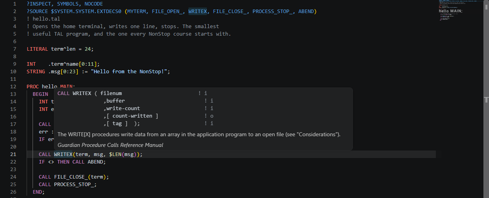
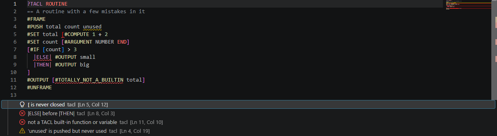
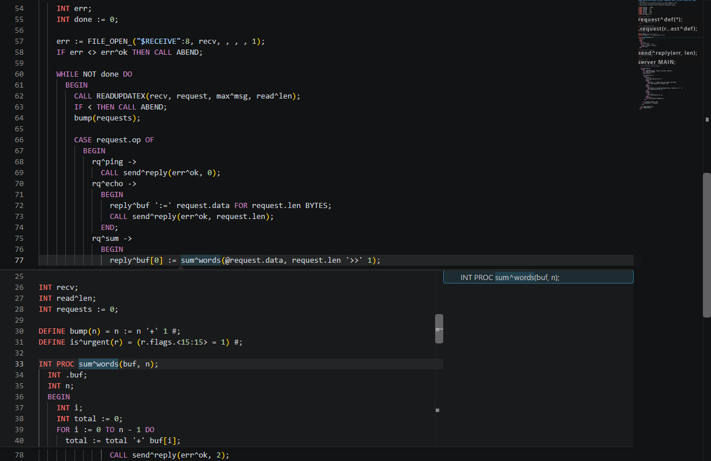
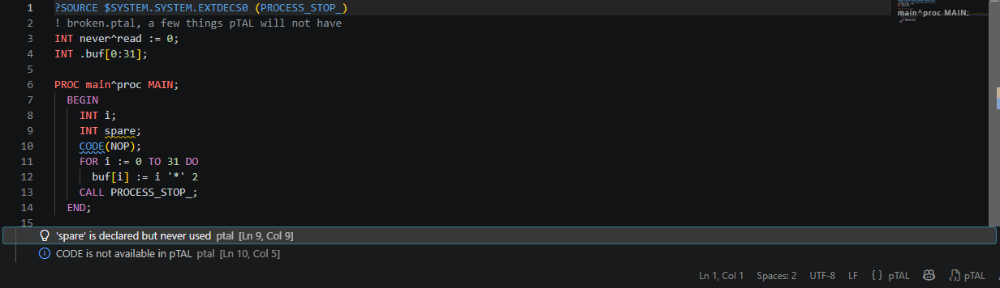
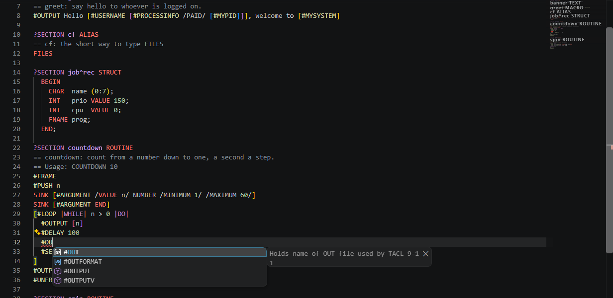
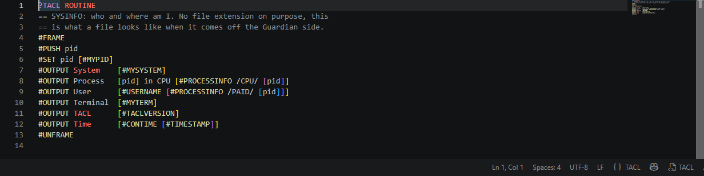

# tal-lsp

G'day! 

A language server for TAL, pTAL and TACL

This is, I think, the first Language server protocol for Tandem Nonstop languages. 

## What It Does

**TAL and pTAL**

- **Diagnostics** that say what went wrong in words. Unused variable warnings. pTAL mode flags `CODE`, `STACK`, `STORE`, `USE` and `DROP`, TAL mode flags the pTAL-only words.
- **Autocomplete** for keywords, every symbol in the file with its type, the `$` standard functions and all 383 Guardian procedure calls.
- **Hover** for what a thing is, its type and where it was declared. DEFINEs show their expansion. Guardian procedures show the TAL calling syntax from the manual, `! i,o` annotations included.
- **Go to Definition** and **Document Symbols**.



**TACL**

- **Diagnostics** for unbalanced `[ ]`, a `{` comment with no `}`, a `|label|` outside `#IF`, `#CASE`, `#LOOP` or `#DEF`, `|ELSE|` before `|THEN|`, `|OTHERWISE|` not last, `#LOOP` labels out of order, `?TACL` not on line one, a `~` before a non-metacharacter, lines over 239 characters, a `#name` that isn't a built-in, and `#PUSH`ed variables never used.
- **Autocomplete** that follows context. `#` gives the 229 built-ins, `|` the labels, `?` the directives, `[#ARGUMENT` its alternatives, `?SECTION name` the variable types, and anywhere else the `:UTILS:TACL` commands plus your own variables.
- **Hover** for every built-in and command with its description from the reference manual.
- **Go to Definition** and **Document Symbols** for `?SECTION`s, `#DEF`s and STRUCT items.



## TAL



Yes, that caret in `sum^words` is a valid identifier character. Yes, `:=` is assignment. Yes, `IF <` tests the hardware condition code the last call left behind. Yes, `#` terminates DEFINE bodies because semicolons were already taken. Yes, `'+'` with the quotes is unsigned addition, because why have one addition when you can have two.

TAL sits somewhere between C and Pascal with hardware-level features for fault-tolerant transaction processing. It was designed by Tandem Computers for their NonStop architecture, machines built in pairs so that if one dies the other picks up without dropping a single transaction. The language reflects that philosophy: practical, cautious, and deeply suspicious of anything that might crash.

## pTAL



pTAL is the portable dialect, the same language with fewer ways to touch the registers.

## TACL



TACL is the NonStop command language and also a programming language with macros, routines and structs. Square brackets evaluate, `==` starts a comment, vertical bars make labels, a tilde escapes, and every variable is a stack. Its wonderful when you get to look at it all the time because of your day job.

## Files Without Extensions

Guardian has no file extensions, so the extension reads the first line. `?TACL` or `?SECTION name TYPE` opens as TACL. A compiler directive, a `!` comment or a `PROC`, `NAME`, `LITERAL`, `INT`, `STRING`, `STRUCT` or `DEFINE` declaration opens as TAL. For anything else, right-click the file and pick **NonStop > Treat as TAL / pTAL / TACL**. The choice is written to the workspace's `files.associations` so it sticks; turn `tal.rememberAssociations` off if you'd rather it didn't. `.tal`, `.ptal` and `.tacl` work too.



## Vibecoding Ya Switch

The language server is not only for people. Cursor and GitHub Copilot read what it reports, so the model gets the same diagnostics, definitions and hover text you do. I tried this on Cursor with the free credits. Without the LSP, Grok knew nothing about TACL. It skipped the `?TACL ROUTINE` line and threw in C features. With the LSP running it knew what it was doing. Pretty please check with your company's policies on AI before you go chucking an LLM into a NonStop computer. I would like my debit card to work :-)

## Building

```bash
make
```

GCC with C99 support. That's the dependency list. The Guardian and TACL tables are generated from the manuals and checked in as C.

## VS Code Extension

```bash
cd vscode
npm install && npm run compile
npx @vscode/vsce package --allow-missing-repository
code --install-extension tal-lsp-*.vsix
```

Or install from the [Marketplace](https://marketplace.visualstudio.com/items?itemName=ZaneHambly.tal-lsp).

## Testing

```bash
python3 test_lsp.py
```

## Reference

Built from the TAL Reference Manual (526371-001), the TAL Programmer's Guide (096254), the pTAL Reference Manual (523746-009), the TACL Reference Manual (429513-017), the TACL Programming Guide (107365) and the Guardian Procedure Calls Reference Manual (522629-030). If you can find copies, they're genuinely well-written technical documents. 

## Related Projects

If you've enjoyed providing tooling for financial infrastructure that could, at any moment, be processing something terribly important, you might also like:

- **[talc](https://github.com/Zaneham/talc)**, a compiler/transpiler for TAL. Very much work in progress
- **[Skyhawk](https://github.com/Zaneham/Skyhawk)**, JOVIAL J73 compiler. The language that flies fighter jets, compiled from scratch in C99.
- **[BarraCUDA](https://github.com/Zaneham/BarraCUDA)**, CUDA compiler targeting AMD, NVIDIA, and Tenstorrent GPUs. What happens when you look at NVIDIA's walled garden and think "how hard can it be?"
- **[JOVIAL LSP](https://github.com/Zaneham/Jovial-LSP)**, language server for F-15 avionics code. Same idea, different era of computing.

## Contact

**Zane Hambly**, my contact information is available at zanehambly.com :-) 


## License

Apache 2.0, (c) 2026 ZH
